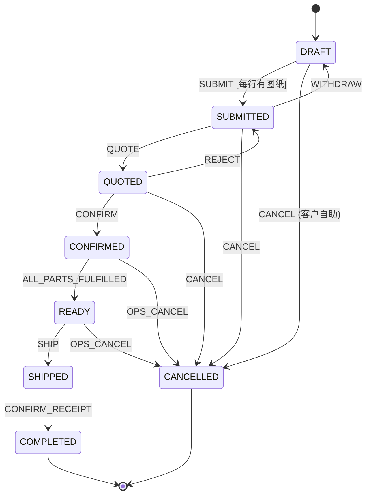
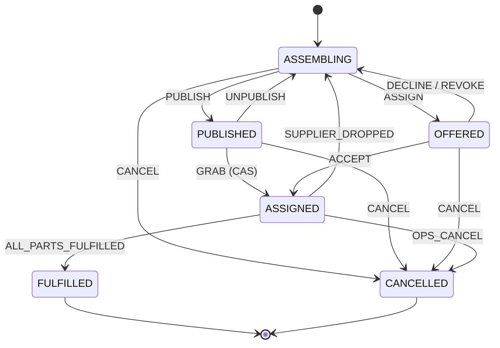
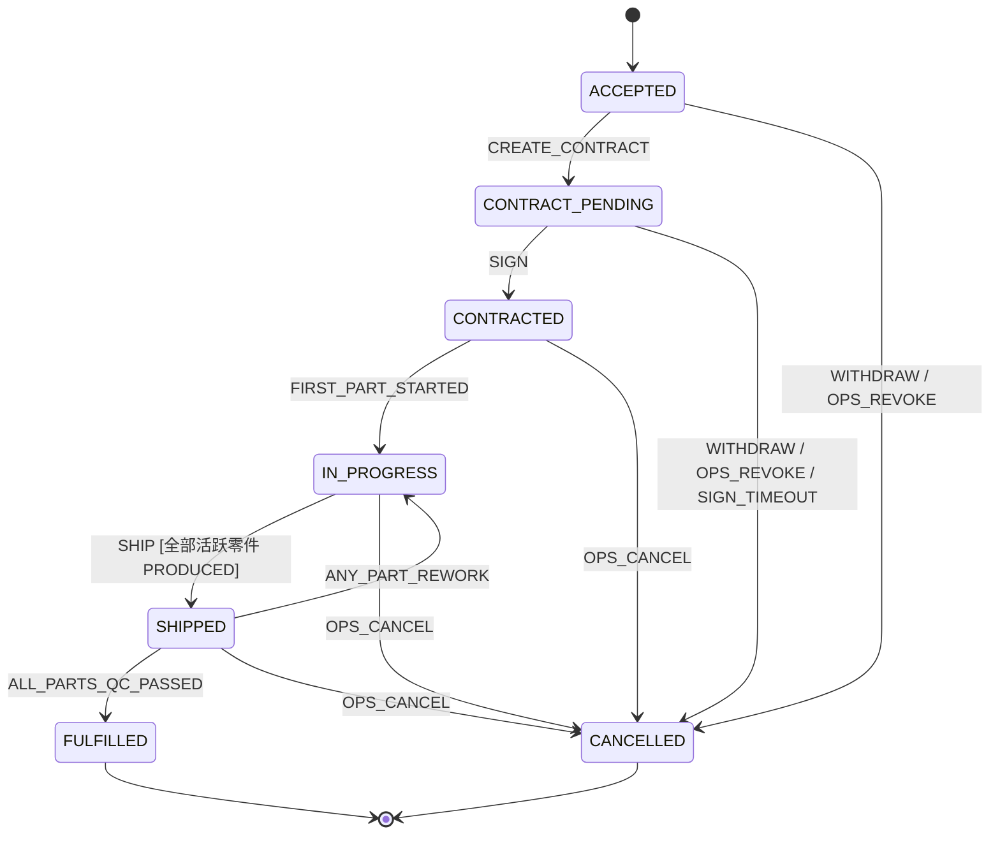
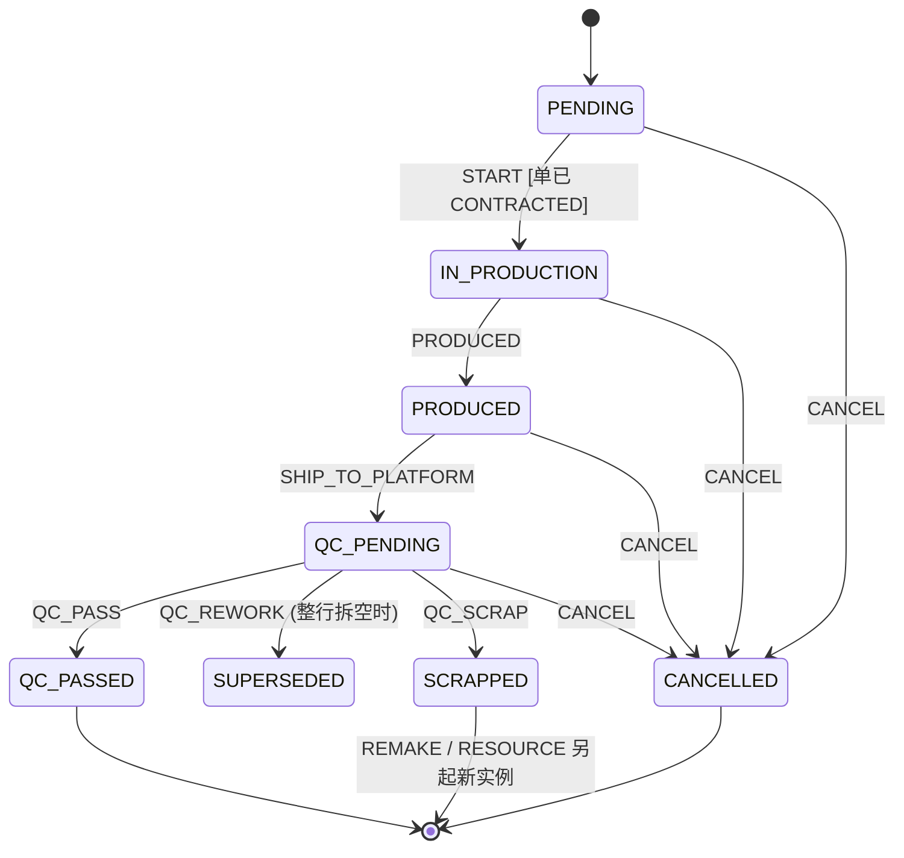

# 12 — 订单与零件状态机

> 编写日期：2026-09-08 ～ 09-09 ｜ 状态：**骨架已拍板，状态机本身大部分是【建议】，不能直接照着建**
>
> ## ★ 2026-09-09 修订：区分「需求方定的」和「助手提的」
>
> 本文档原先整篇标注为「已拍板」，实际上其中**状态名、事件名、守卫、触发者、
> 自动流转**大多是助手命名和裁定的，需求方没有逐个确认过。已按文档 10 / 11 的标注约定重标：
>
> | 标注 | 含义 |
> |---|---|
> | 【已拍板】 | 需求方明确说过的，**是决策** |
> | 【建议】 | 助手的判断，**不是决策**，可以被推翻 |
> | 【待确认】 | 没人定过，或与已定的东西冲突，**动手前必须问** |
>
> **已删除**（凭空造的政策，见 CLAUDE.md 强制约束「不许胡编乱造」）：
> - `SHIPPED --AUTO_COMPLETE [N 天]--> COMPLETED`：系统替客户认收货。谁定的 N、要不要自动，全没依据。
> - `CONTRACT_PENDING --TIMEOUT [N 天]--> CANCELLED`：不签超时自动废单。同上。
> - 原 §9「已定的默认假设（**未反对即按此建**）」整章：这是 C5 点名禁止的做法 —— 报备不是授权。
>
> **★ 2026-09-09 下午：原先那两处冲突（§3 派单机制、§4 合同锁定点）已由需求方当面逐条定掉，
> 见两节开头的【已拍板】表。其余【待确认】仍未解。**
>
> ---
>
> **本文档只定状态、事件、守卫、触发者和跨单传播规则，不定表字段细节、不定接口、不写代码。**
>
> 引擎思路（COLA 式表驱动）：`(当前状态, 事件, 守卫) → (目标状态, 动作)`，
> `next()` 是纯函数；状态存在订单/零件表里，状态机只是裁判。**这部分是工程决策，不是业务需求。**
>
> ⚠ **`status` / `fulfillment_status` / `superseded_by` / `rework_count` 这四个列
> 目前在任何迁移里都不存在**（`2026-09-08_05` 只建了归属、编号、溯源、时间、version）。
> 下文 §2–§7 读起来像它们已落库，实际没有。要建见 §11。

---

## 0. 五条总原则（违反任何一条 = 设计错误）

1. **状态只在自己的域内变。** 客户单、运营单、供应商单各管各的生命周期，只被自己域内的事件推动。**没有任何订单的状态是被另一张订单直接写的。**
2. **零件是履约的最小单元。** 真正被生产、发货、质检的是零件；物理进度只在叶子 `supplier_order_part` 上发生，它是全链**唯一跑真状态机的零件**。
3. **跨单靠"同事务事件 + 沿零件链向上聚合"，绝不级联写。** 下游转态后，在**同一个事务**里沿 `upstream_part_id` 向上重算上游零件汇总；汇总满足条件时触发上游订单**自己**状态机的守卫事件。每层只改自己、只看自己的零件。
4. **客户订单是必须交付的义务。返工、报废、供应商退单、运营单作废，全是供应链内部的事。** 它们只改变"货怎么做出来"，**永远不改变客户单的结果**。客户零件的终态只有 FULFILLED（合格到仓）或 CANCELLED（客户单自身取消）；供应侧的 SCRAPPED / CANCELLED **绝不**上传成客户零件的终态。
5. **转移表是数据，不是 if-else；流转用 CAS，不先查后改；状态机里不写业务。** `next()` 只判"能不能"，Action / 领域服务做"做什么"。CAS 条件里带租户归属。

---

## 1. 实体关系回顾（骨架表已建，迁移 `2026-09-08_05`）

```
customer_order ─1:N─ customer_order_part ──┐
ops_order      ─1:N─ ops_order_part  ─────┤  下游零件.upstream_part_id → 上游零件
supplier_order ─1:N─ supplier_order_part ─┘  + source_customer_order_id / source_customer_id 快照
                                            所有零件实例 → part_design（同一种零件，归某客户）
```

- 订单之间**不直连**；多对多 + 溯源全靠零件派生链。
- 一张运营单**整单**交给**一家**供应商（ops_order : supplier_order = 1 : 1）；一张运营单里的零件**可以来自多个客户单**。
- 派生只增不改：从不搬动零件实例；需要"换一条链"时新建实例并用 `superseded_by` 接上（见 §5）。

### ★ 交期：整单一个，运营填 —— 【已拍板】2026-09-10

交期不按零件行承诺，一张单一个交货日；对供交期 = 客户交期 − 缓冲。
详见文档 13 §2.06（它和原价一起填，所以记在那边）。

### ★ 每一行零件都带数量 —— 【已拍板】2026-09-09

**一行 = 一批，不是一个物理件。** 每一行有一个 `quantity`（≥1）。

| 定的 | 内容 |
|---|---|
| 粒度 | **一行带数量，质检记个数**（合格 N / 返工 N / 报废 N），不逐件建行、不发序列号 |
| 部分返工 | **原行留着，另开一行装返工的那几件** |
| 部分发货 | **不发**。同一行里 97 件好了、3 件在返工，等齐了整批一起走（与「整单一次发齐」一致） |

> ⚠ **这条推翻了本文档 2026-09-08 初稿的隐含假设**：初稿全篇按「一行 = 一个物理件」写，
> 「数量」两个字出现 0 次，而骨架表 `customer_order_part` 至今也没有数量列。
> **`quantity` 列必须补**（三张零件表都要），补之前不要按本文档建代码。

**由此推导**（这是推导，不是需求方原话）：`SUPERSEDED` 只在**整行被拆空**时才用 ——
100 件里返工 3 件，原行数量降到 97 并正常完成，新行数量 3 从 `PENDING` 重走；
100 件全要返工时原行数量降到 0，此时原行才进 `SUPERSEDED`。
报废走同一套（`SCRAPPED` 同理）。**同一客户零件下所有活跃行的数量之和恒等于客户要的数量。**

**拆给多家时的分配**（D3 / D12「同一零件数量可拆多家」）—— 【已拍板】2026-09-10：

**必须一次派完**：`各供应商分配数量之和 = 该客户零件行的总数量`。
可以分给多家，但加起来必须等于总数；**不允许只派一部分**。
文档 1 原先写的 `≤` 已改成 `=`，文档 3 要求的「未分配数量」看板随之作废。

代价：凑不齐供应商时这一行整个派不出去，停在待派单 —— 这是需求方选的，
比「漏分了没人发现」更容易看见。

【待确认】这条不变式守在哪一层（运营零件层还是供应商零件层），以及并发派单时怎么保证
（文档 3 §2.4 要求三层守护：DB 约束 + Service 校验 + 集成测试）。

---

## 2. 客户订单 `customer_order` —— 一条主流程

**维度**：只做主流程一台机。生产/发货**进度**不是它的状态，是沿零件链聚合出来的（§7）。

### 状态
`DRAFT` → `SUBMITTED` → `QUOTED` → `CONFIRMED` → `READY` → `SHIPPED` → `COMPLETED`；终态 `COMPLETED` / `CANCELLED`。

### 转移表
```
DRAFT      --SUBMIT [每行都有传完的图纸]--> SUBMITTED   (客户)   ← 【已拍板】2026-09-14；提交时锁定各行图纸版本
SUBMITTED  --WITHDRAW---------------> DRAFT       (客户，撤回改零件)
SUBMITTED  --QUOTE------------------> QUOTED      (运营)          ← 报价实体待定，暂裸转移
QUOTED     --REJECT-----------------> SUBMITTED   (客户，打回重报，可来回多次)
QUOTED     --CONFIRM----------------> CONFIRMED   (客户)          ← 报价有效期等守卫待报价域定后挂上
CONFIRMED  --ALL_PARTS_FULFILLED----> READY       (系统，聚合守卫：该单全部客户零件 = FULFILLED)
READY      --SHIP-------------------> SHIPPED     (运营，整单一次发给客户)
SHIPPED    --CONFIRM_RECEIPT--------> COMPLETED   (客户)
DRAFT --CANCEL---------------------> CANCELLED   (客户自助)      ← 【已拍板】只有草稿能自助取消
SUBMITTED | QUOTED --OPS_CANCEL-----> CANCELLED   (运营，代客户取消)
CONFIRMED | READY --OPS_CANCEL------> CANCELLED   (运营，必填原因)  ← 【已拍板】见下方
```

> ★ **【已拍板】2026-09-14，需求方本人（第 2 步实施时）：**
>
> | 问题 | 定的 |
> |---|---|
> | 提交条件 | 每个零件行都有 **图号 + 名称 + 数量 + 至少一份传完且校验通过的图纸**。原先的守卫只写了「≥1 零件」，「信息完整」从来没定义过 |
> | 客户在订单上还填 | 订单名称、**期望交期（仅参考，不是交期）**；零件行上的材料、表面处理（自由文本，可选） |
> | 图纸版本锁定 | **提交时锁**。草稿里随便增删图纸；同一图号再次下单沿用上次锁定的那一版，换图纸就开新版本 |
>
> 已实现的状态只有 `DRAFT` / `SUBMITTED` / `CANCELLED`，其余随报价（第 3 步）逐个加。
> `SUBMITTED → DRAFT`（撤回）仍是【建议】，没有实现。

> ★ **【已拍板】2026-09-17，需求方本人（第 3 步实施时）：** 客户可以拒绝报价，运营可以重报。已实现：
>
> | 转移 | 谁 | 实现 |
> |---|---|---|
> | `SUBMITTED --QUOTE--> QUOTED` | 运营 | 发出报价；订单是 `QUOTED` 时再发一次 = 重报（旧版作废，状态不变） |
> | `QUOTED --REJECT--> SUBMITTED` | 客户 | 拒绝当前报价，等运营重报；**次数不限**（没有定上限） |
> | `QUOTED --CONFIRM--> CONFIRMED` | 客户 | 确认当前报价，锁汇率。**不设有效期**，所以没有有效期守卫 |
>
> 报价实体、版本、快照见文档 13 §2.07 / §3.5 和 `changelog/2026-09-17_quote/`。
> 运营代客户取消（`OPS_CANCEL`）、确认后往下走（`READY` 等）都还没实现。
> 运营端只看得到提交过的订单，草稿对运营不可见。

> ★ **【已拍板】2026-09-09，需求方本人：**
>
> - **客户自助取消只限 `DRAFT`。** 提交之后客户端没有取消按钮，要撤得找运营。
> - **运营可以取消已确认的单，但必须填原因**，原因和操作人落审计
>   （审计动作按 CLAUDE.md §6：`order.status_change`，不是 `order.update` 带个 status）。
>
> 这和 §0 原则 4 引的原话「客户的订单必须完成」是并存关系：原则 4 说的是
> **不因为供应侧出事就取消客户单**（返工报废只针对供应商）；`OPS_CANCEL` 管的是
> 客户侧或商务侧的例外，走人工并留痕。两者管的不是同一类情况。

> **【建议】以下仍是助手拟的，不是决策**：七个状态的名字；`WITHDRAW` 由客户触发；
> `REJECT` 可以来回多次。**动作归谁、能不能自助、能来回几次，都是需求的一部分**
> （CLAUDE.md §10 C5），需逐条确认。（取消权限那一条已于 2026-09-09 定掉，见上。）

- 【已删除】原本还有 `SHIPPED --AUTO_COMPLETE [N 天]--> COMPLETED`（系统定时替客户认收货）。
  N 是多少、要不要自动、超时后果，全无依据 —— 而客户会据此认为货已签收。
- `SHIPPED` 之后的取消/退换 = **售后**，不在本文档（待定）。
- `READY` 的守卫看的是客户零件的 **FULFILLED**（§7 映射后的值），不直接看叶子。



---

## 3. 运营订单 `ops_order` —— 一条主流程，两种派法

> ★ **2026-09-18 已实现（第 4 步 4b）**：组装中 → 定向派出（OFFERED）/ 挂全市场（PUBLISHED）→ 被接下（ASSIGNED）；
> 收回（UNPUBLISH / REVOKE）、全部拒接、供应商退单、运营收回供应商都回组装中。定向派单按轮次记（`dispatch_round`），
> 一家拒接只移出他（2026-09-18 拍板）。**没做**：取消（CANCEL / OPS_CANCEL）、FULFILLED（生产 / 质检还没做）。
> 实现见 `changelog/2026-09-18_dispatch/`。

**结构决策**：整单交给一家。

> ★ **【已拍板】2026-09-09，需求方本人：两种派法都要，运营每单二选一。**
>
> 这**扩展了** D11（D11 只说定向派给几家、先到先得）。现在的口径是：
>
> | 派法 | 谁看得到 | 谁接 |
> |---|---|---|
> | **定向派单** | 只有被派到的那几家 | 这几家之间先到先得 |
> | **挂全市场** | 全部入驻供应商 | 先到先得 |
>
> **两条路平行，不互相转化** —— 没有「定向超时自动转全市场」这种事，
> 运营在派单那一刻选定一条，选了就是那条。
>
> 由此：`supplier/HallPage` 要能同时装下「派给我的」和「市场上公开的」两类，
> `ops/DispatchPage` 的派单动作要先让运营选走哪条路。

### 状态
`ASSEMBLING`（组装中）/ `PUBLISHED`（已挂全市场待抢）/ `OFFERED`（已定向派出待接）/ `ASSIGNED`（已有供应商接下）/ `FULFILLED` / `CANCELLED`。

### 转移表
```
ASSEMBLING --PUBLISH [≥1 零件]-------> PUBLISHED   (运营，选了「挂全市场」这条路)
ASSEMBLING --ASSIGN(某几家供应商)-----> OFFERED     (运营，选了「定向派单」这条路)
PUBLISHED  --GRAB-------------------> ASSIGNED    (供应商，全市场先到先得)
PUBLISHED  --UNPUBLISH--------------> ASSEMBLING  (运营撤回市场)
OFFERED    --ACCEPT-----------------> ASSIGNED    (供应商)
OFFERED    --DECLINE----------------> ASSEMBLING  (供应商拒接，回运营再定)
OFFERED    --REVOKE-----------------> ASSEMBLING  (运营收回指派)
ASSIGNED   --ALL_PARTS_FULFILLED----> FULFILLED   (系统，聚合守卫：未被替代的活跃零件全 QC_PASSED)
ASSIGNED   --SUPPLIER_DROPPED-------> ASSEMBLING  (系统：供应商退单 / 不签 / 待签超时 的事件，回来重派)
ASSEMBLING | PUBLISHED | OFFERED --CANCEL--> CANCELLED (运营)
ASSIGNED   --OPS_CANCEL-------------> CANCELLED   (运营；→ 事件 → 对应 supplier_order 走自己的取消；零件级联见 §6)
```

- **`GRAB` / `ACCEPT` 的动作**：同一事务内生成 `supplier_order`（ACCEPTED）+ 其 `supplier_order_part`（从本单 `ops_order_part` 派生）。
- 运营单不承载合同状态；合同阶段在供应商单上（§4）。



---

## 4. 供应商订单 `supplier_order` —— 粗主线

> ★ **2026-09-18 / 2026-09-20 已实现**：`ACCEPTED`（等合同）/ `CONTRACT_PENDING`（等签字）/ `CONTRACTED`（签了 = 锁定）/ `CANCELLED`
> （原因 WITHDRAWN 供应商退单 / REVOKED 运营收回 / SIGN_TIMEOUT 超时未签）。
>
> | 项 | 定的（2026-09-20，需求方本人） |
> |---|---|
> | 合同内容 | **本轮只做交互和签字**，不生成 PDF、不写条款正文；页面只展示系统里已有的数据（双方、零件明细、单价 / 小计 / 合计、交期）。备注、付款条件、条款正文等定了再加 |
> | 签字超时 | **7 天，从供应商接单那一刻算起**（不是从建合同算）。到点没签 → 供应商订单自动取消、生产订单回组装中重派 |
> | 签字前 | 供应商可退单，运营可收回，运营还可作废合同重建 |
> | 签字后 | 锁定：退不了、收不回、改不了 |
>
> 因为合同眼下没有自己的内容字段，**没有单开合同表**，就是供应商订单上的几个时间戳；
> 等条款 / 附件 / 付款条件定下来再按 §10 拆成合同域。生产、质检、发货仍未做。

> ★ **【已拍板】2026-09-09，需求方本人，逐条确认：**
>
> | 问题 | 定的 |
> |---|---|
> | 锁定点 | **两步：建合同 → 签字才锁**（不是「建完即锁」） |
> | 谁建合同 | **运营建，供应商签** |
> | 签字前谁能退 | **双方都能退** —— 供应商可退，运营也可在签字前收回重派 |
>
> 需求方早先的原话是「供应商接单还有一个创建合同的过程，创建完合同就锁定了」，
> 本次当面确认后改为上表口径。**原话保留在这里，是为了让后来人知道口径变过一次。**
>
> 由此 `ACCEPTED` 和 `CONTRACT_PENDING` 都是**可退的**，`CONTRACTED` 才是锁定态。
> 「签字前的这段窗口客户已经确认了、单子悬着」这个风险仍然存在 →
> 超时兜底见下方【待确认】。

**结构决策**：供应商发货**整单一次发齐**（发给我们质检）—— 【已拍板】2026-09-09，
不做分批交付；一件做不出来整单卡着，这个代价需求方当场确认接受。分批的讨论见 §10；
"我们 → 客户"的交付是客户单的事（§2）。

### 状态
`ACCEPTED` / `CONTRACT_PENDING` / `CONTRACTED` / `IN_PROGRESS` / `SHIPPED` / `FULFILLED` / `CANCELLED`。

### 转移表
```
ACCEPTED         --CREATE_CONTRACT-----> CONTRACT_PENDING (运营建合同，待签)     ← 合同实体待定，暂裸转移
CONTRACT_PENDING --SIGN----------------> CONTRACTED       (供应商签 = 锁定，不可退不可改)
CONTRACTED       --FIRST_PART_STARTED--> IN_PROGRESS      (系统，聚合：首个零件 START)
IN_PROGRESS      --SHIP----------------> SHIPPED          (供应商，整单发给我们；守卫：全部活跃零件 PRODUCED)
SHIPPED          --ALL_PARTS_QC_PASSED-> FULFILLED        (系统，聚合：未被替代的活跃零件全 QC_PASSED)
SHIPPED          --ANY_PART_REWORK-----> IN_PROGRESS      (系统，聚合：有零件被判返工 / 报废后重做)
ACCEPTED | CONTRACT_PENDING --WITHDRAW-> CANCELLED (供应商退单，签字前允许)
ACCEPTED | CONTRACT_PENDING --OPS_REVOKE-> CANCELLED (运营签字前收回重派)
CONTRACT_PENDING --SIGN_TIMEOUT---------> CANCELLED (系统，挂太久自动回待派；时限待给)
任一非终态        --OPS_CANCEL(事件)-----> CANCELLED (来自运营单的取消)
```

- 【已删除】原本还有 `CONTRACT_PENDING --TIMEOUT [N 天]--> CANCELLED`（不签超时自动废单）。
  N 是多少、超时后果、要不要自动，全无依据。
- **【已拍板】2026-09-09：签字超时自动回待派单。** `CONTRACT_PENDING` 挂过时限 →
  这张供应商单自动取消，运营单 `SUPPLIER_DROPPED` 回 `ASSEMBLING` 重派。
  **【待确认】时限是多少** —— 需求方还没给数字，做成可配置，**上线前必须拿到**。
  注意这条和上一版被删掉的 `TIMEOUT --> CANCELLED` 形状相似但性质不同：
  上一版的 N 是助手编的，这一版是需求方定的机制、数字待给。
- 返工件 / 重做件做好后**单件**再发给我们（"整单一次发"只管首次交付）。



---

## 5. 叶子零件 `supplier_order_part` —— 唯一的真物理机（含质检、返工、报废）

**质检**：供应商做好 → 整单发给**我们** → **我们按零件质检** → 合格 / 返工 / 报废。质检是零件维度，决定权在运营。

> ★ **2026-09-20 已实现（第 6 步）**：本节的状态机、拆行、溯源、数量守恒都已落地
> （迁移 `2026-09-20_02_production.sql`，`ProductionService`，`ProductionFlowIT` 7 个用例）。
>
> | 项 | 定的（2026-09-20，需求方本人） |
> |---|---|
> | 本轮范围 | 做到**质检完成**为止；发给客户（物流单号、客户确认收货）下一轮 |
> | 报工粒度 | 每行只报**开工**和**完工**两个动作，**不报件数** |
> | 发货条件 | **整单全部完工才能发**给平台；返工 / 重做的行做完之后再发那几行 |
> | 报废补料 | 本轮只做 **REMAKE（原厂重做）**；**RESOURCE（换家）和差价扣款下一轮**，界面上不出现 |
>
> 实现上与本节文字的两处差异（都是刻意的，不是遗漏）：
> - 原行合格 0 件时**件数不动**、状态改 `SUPERSEDED` —— 库里 `quantity` 的 CHECK 是 `>= 1`，减不到 0。
>   守恒的口径因此是「活跃行件数 + 还没补料的报废件数」，被替代的行不计入。
> - `ops_order_part` **不存状态**（§7 那一行），它可以由叶子行现算；多存一份就多一处要同步。

### 状态
`PENDING` / `IN_PRODUCTION` / `PRODUCED` / `QC_PENDING` / `QC_PASSED` / `SUPERSEDED` / `SCRAPPED` / `CANCELLED`。

> `SUPERSEDED`（本行被拆空之后的终态）**这个名字是助手起的【建议】**。
> 需求方定的是语义不是名字：「返工另开一行装那几件，原行留着」，
> 只有原行数量被拆到 0 时才用这个终态。名字随便改，语义不能改。

### 转移表
```
PENDING       --START---------------> IN_PRODUCTION  (供应商；守卫：所属供应商单已 CONTRACTED)
IN_PRODUCTION --PRODUCED------------> PRODUCED       (供应商，做好等发)
PRODUCED      --SHIP_TO_PLATFORM----> QC_PENDING     (首次由整单 SHIP 批量触发；返工/重做件单件触发)
QC_PENDING    --QC_PASS-------------> QC_PASSED      (运营；终态 = 该件履约完成)
QC_PENDING    --QC_PASS(部分)-------> QC_PASSED      (运营；本行数量减为合格数)
QC_PENDING    --QC_REWORK(N 件)-----> 拆出新行        (运营；本行数量 -N，新行数量 N 从 PENDING 重走)
QC_PENDING    --QC_REWORK(全部)-----> SUPERSEDED     (运营；本行被拆空，superseded_by = 新行)
QC_PENDING    --QC_SCRAP------------> SCRAPPED       (运营；终态，只标记，不自动生成任何东西)
任一非终态     --CANCEL(级联事件)------> CANCELLED      (见 §6)
```

### 报废之后（补料）—— 两条命令，都是"生成新实例"，不是报废件的转移
- `SCRAPPED` 且 `superseded_by` 为空 = 运营的**待处理报废**清单。运营二选一：
  - **REMAKE（原厂重做）**【已拍板】2026-09-09：**这是默认路径**。在**同一张** `supplier_order` 里建新
    `supplier_order_part`（新 part_no，PENDING），上游仍是同一 `ops_order_part`；旧件 `superseded_by = 新件`；供应商单回 `IN_PROGRESS`。
    **成本【已拍板】：供应商自担** —— 重做不加钱，对供价不变，结算按原数。系统不需要算额外费用。
  - **RESOURCE（换家）**【已拍板】是运营的例外选择，不是默认：从同一 `customer_order_part` 重新派生一条新链进**另一张**运营单
    （新 `ops_order_part` → 之后新 `supplier_order_part`），旧链 `superseded_by` 接上。
    **责任【已拍板】2026-09-09：原厂一律承担。** 换家产生的差价从原供应商的结算里扣，
    系统要能算出这个差价（新链的对供价 − 原链的对供价）。
    【待确认】换家的触发条件、是否需要客户/原供应商知情 —— 仍未定。
> **返工和「报废后原厂重做」在结构上是同一件事** —— 从原行拆出问题件、
> 新行在同一张供应商单里从 `PENDING` 重新走一遍、`superseded_by` 接上溯源。
> 区别只在拆出去的那几件是「还能救」（返工）还是「救不回来」（报废）。
> 两者成本都是**供应商自担**（2026-09-09 已拍板）。
>
> 数量守恒是这里的硬不变式：**原行减掉的件数 = 新行的件数**，任何时候
> 同一客户零件下所有活跃行数量之和不变。这一条要有测试钉死，别只写在文档里。

- **各单 FULFILLED 的守卫 = 所有"未被替代"的活跃零件全 QC_PASSED。** 由此：原厂重做时新件仍在原单 → 原单等新件合格才完成；换家时需求已离开原单 → 原单可正常完成，原厂只对剩下的零件负责。
- 溯源两头都在：新件查得到"替代了哪个报废件"，报废件查得到"被谁替代"。



---

## 6. 取消：按零件走，不按整单

**问题**：一张运营单里混着多个客户的零件。客户 A 取消不能把 B 的零件也取消掉。

**规则**
- `ops_order_part` / `supplier_order_part` 各加 `CANCELLED`（客户零件的取消只来自客户单自身，见原则 4）。
- **客户单 OPS_CANCEL**（CONFIRMED / READY）→ 只取消**它派生出去的**零件（沿链向下 CANCELLED）；下游运营单 / 供应商单若还有其他客户的活跃零件则**继续**；
  **【已拍板】2026-09-09：活跃零件归零时不自动关单，标成待处理提醒运营。**
  自动取消一张供应商单是有后果的动作 —— 对方可能已经备料，已备的料怎么算要人去谈。
  系统只负责让这张空单不被漏掉，不替人做毁约决定。
- **运营单 OPS_CANCEL** → 其全部零件 CANCELLED，对应供应商单走自己的取消；里面的**客户零件需求并没消失** → 回"待重派"。
  **【已拍板】2026-09-09**：零件自动回到「待派单」池子，**由运营重新组包派出**，不自动重派，
  **也不通知客户** —— 客户端状态不倒退（见 §7），交期若因此变化走单独告知。
- **供应商退单 / 不签 / 超时** → 供应商单 CANCELLED，其零件 CANCELLED，运营单 `SUPPLIER_DROPPED` 回 ASSEMBLING 重派（运营单和它的零件不取消，只是回到待派）。
- **方向不对称**：向下的取消（客户 → 运营 → 供应商）会级联；向上（供应侧出事）**永远不取消客户单**，只是让客户零件回到待重派。

---

## 7. 客户视角的零件状态：映射，不是镜像

| 表 | `fulfillment_status` 取值 | 含义 |
|---|---|---|
| `supplier_order_part`（叶子） | §5 全部 7 个状态 | 真状态机 |
| `ops_order_part` | ~~与叶子同值~~ **不存**（2026-09-20 实现时的取舍）：运营页面按叶子行现算 | 运营看供应细节 |
| `customer_order_part` | **`PENDING` / `IN_PROGRESS` / `FULFILLED` / `CANCELLED`** | 客户只看"到没到" |

**叶子 → 客户零件的映射**
```
无活跃下游链（未派 / 被取消 / 报废待重派）  → PENDING      (需求开着，等运营派)
IN_PRODUCTION | PRODUCED | QC_PENDING     → IN_PROGRESS
返工 / 报废后 REMAKE 或 RESOURCE 的新链      → IN_PROGRESS  【已拍板】2026-09-09，不倒退
QC_PASSED                                → FULFILLED    (终态)
客户单自身 CANCEL / OPS_CANCEL             → CANCELLED    (唯一能给客户零件终态的取消)
```
- 客户零件的 `READY` 守卫看 `FULFILLED`。
- 客户零件**永远不显示** SCRAPPED、供应侧 CANCELLED、REWORK —— 那些折成 IN_PROGRESS / PENDING。
  这一条有出处：需求方原话「客户的订单必须完成，返工报废是针对供应商的」。

> ★ **【已拍板】2026-09-09：返工 / 重做期间客户端一直显示「进行中」，状态不倒退。**
> 客户看不到内部波折。**代价要知道**：交期会因此变化而客户端状态没有任何提示，
> 所以交期变更必须走单独的告知，不能指望客户从状态上看出来。

> ★ **【已拍板】2026-09-09：客户零件状态由系统从叶子自动推导，运营不能手动改。**
> 好处是没人会忘记更新；代价是运营无法人为控制客户看到什么，
> 所以任何需要「让客户知道」的事（交期变更、返工延误）都得走单独的通知，不能靠改状态表达。

---

## 8. 事件与事务

- **向上传播同事务同步**：叶子 CAS + 上游回写 + 上游聚合转态在同一个 `@Transactional` 里（全在一个库），要么全成要么全回滚。**不会出现"叶子合格了、客户单没更新"。**
- **outbox / 本地消息表只给对外消息**（邮件 / 企微 / 通知），不在事务里直接 send。
- **CAS**：`update … set status = 目标, version = version + 1 where id = ? and status = 当前 [and 归属 org = ?]`，`affectedRows == 0` 即被抢先，抛非法流转。业务动作放 CAS 成功之后。
- **并发聚合**：两个零件同时合格、同时触发"全部合格了吗"，只有第一个 CAS 成功把订单推到 FULFILLED，第二个自然失败并忽略。聚合判断在 CAS 条件内重读。
- **接单唯一性**：`→ ASSIGNED` 的 CAS 天然保证只有一家接到，不需要分布式锁。
  （原文写的是 `PUBLISHED → ASSIGNED` 的抢单，那条线本身待确认，见 §3。
  定向派单下同样需要这个 CAS —— D11 是「派给几家，先到先得」。）

---

## 9. 【待确认】原「已定的默认假设（未反对即按此建）」

> **这一章原本叫「已定的默认假设（未反对即按此建）」。**
> 「未反对即生效」是给凭空造的东西加一个免责声明，正是 CLAUDE.md §10 C5
> 点名禁止的做法：**报备不是授权**。三条全部降级为待确认。

1. **【建议】报价 / 合同待定 → `QUOTE`、`CONFIRM`、`CREATE_CONTRACT`、`SIGN` 先做裸转移。**
   这条方向是对的（那两块确实由需求方明确延后了），可以保留为工程做法。
2. **【待确认】两条守卫**：零件 `START` 要求所属供应商单已 `CONTRACTED`；
   供应商单 `SHIP` 要求全部活跃零件 `PRODUCED`。两条都是助手拟的，
   而且第一条依附于 §4 那个未经确认的合同模型。
3. **【待确认】谁能触发**。「端级 + 租户归属」是安全底线（CLAUDE.md §3），这部分是对的；
   但**具体哪个事件归哪一端**（客户能不能自助取消、运营能不能取消已确认单、
   供应商能不能退单）逐条都没定，见 §2 §3 §4 的标注。

   ⚠ 另有一个**实现层面的缺口**：CAS 条件要带租户 org id，但
   `ops_order` 和**四张零件表目前都没有 org 列**（见 `2026-09-08_05`）。
   要么先查父单校验归属、CAS 只带 status，要么给零件表加冗余 org 列 —— 这是建模决策，需先定。

---

## 10. 待定项（不阻塞状态机落地）

| 项 | 归属 | 说明 |
|---|---|---|
| 报价实体、有效期、审批（D14 最简版）、汇率快照 | 报价域 | 挂到 `QUOTE` / `CONFIRM` 的守卫上 |
| 合同实体、对供价、交期、签署信息、文件 | 合同域 | 挂到 `CREATE_CONTRACT` / `SIGN` 上 |
| 取消赔付、返工/报废扣款 | 价格域 | 不改状态机 |
| 售后（SHIPPED 后取消 / 退换 / 索赔） | 待定 | 可能是客户单的一个正交维度 |
| ~~分批交付客户~~ | **已定** | 【已拍板】2026-09-09：不做分批，整单一次发齐；同一零件行内也要等齐（97 件好了 3 件返工，一起等） |
| **我们 → 客户 的发货段** | **已定范围** | 【已拍板】2026-09-10：系统只记**状态 + 物流单号**，客户自己去承运商网站查。装箱、报关、两套贸易条款（DDP / EXW）全部线下，不建 `shipment` / `carton` / `document` 表。⚠ 这是**范围决定**，不是这一段不存在 —— 业务上它照常发生 |
| **质检报告** | **已定** | 【已拍板】2026-09-10：质检报告 + 材质证明**给客户**，随发货在客户端可下载（确认了文档 5 Q4 当时的默认值假设） |
| 审批人 / QC / 取消的细粒度角色 | 角色 | 角色表种值后收紧 |
| 发票 / 回款状态（D15） | 结算域 | 单独一块 |

---

## 11. 落地清单

> ⚠ **这份清单现在不能直接照着做。** §3（市场抢单 vs D11）、§4（合同锁定点）
> 两处与已定内容冲突，§2 §5 §6 §7 §9 里还有若干【待确认】。
> 先把那些定下来，转移表才有确定的内容可落。下面是**定完之后**的步骤。

1. **迁移**：`customer_order` / `ops_order` / `supplier_order` 加 `status`（text + CHECK）；三张零件表加 `fulfillment_status`；`ops_order_part` / `supplier_order_part` 加 `superseded_by`（uuid，可空）；`supplier_order_part` 加 `rework_count`（int，默认 0）；相应索引。
2. **引擎**（`platform/statemachine`，业务无关）：`Transition(from, event) → to` 表 + 守卫接口 + 纯函数 `next()` + CAS `apply()`（带租户条件、抛非法流转）+ 同事务领域事件。
3. **四张转移表**（`domain/order`）作为数据；守卫与动作在领域服务。
4. **向上聚合回写**：事件处理器沿 `upstream_part_id` 回写 `fulfillment_status`（运营层同值、客户层按 §7 映射），并触发上游订单的聚合事件。
5. **测试**：每台机全路径遍历（从转移表自动枚举）、非法流转告警、CAS 并发（两零件同时合格 / 两家同时抢单）、级联取消、报废重做与换家的守卫。
6. **出图**：从转移表自动生成 Mermaid。
   【待确认】本文档 §2–§5 的 mermaid 是手写散文体（一条边上写两个事件、
   `SCRAPPED --> [*]: REMAKE / RESOURCE 另起新实例` 根本不是一条转移、边标签带中文守卫），
   按「漂移即测试红」逐字比对会第一天就红。要么改文档的图，
   要么把对照降级成 `(from, event, to)` 三元组集合比对。
