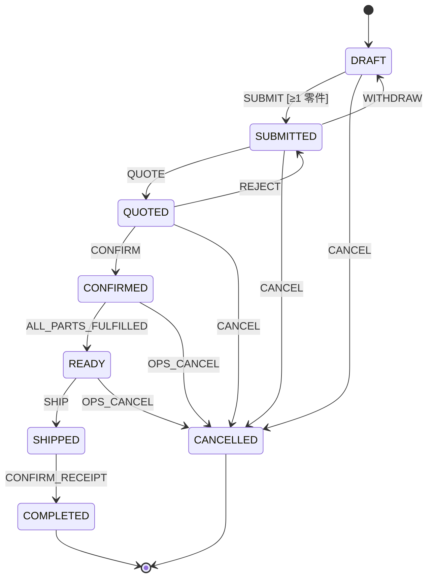
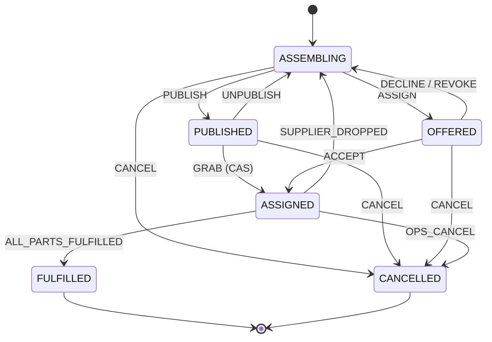
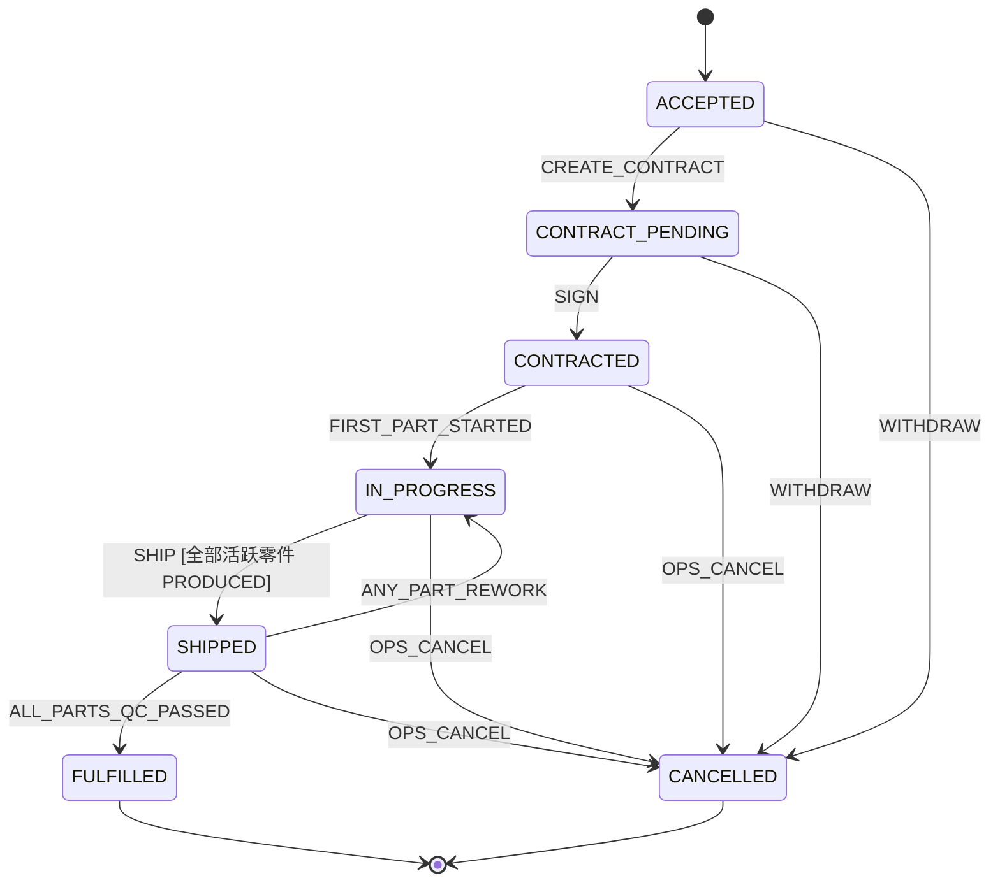
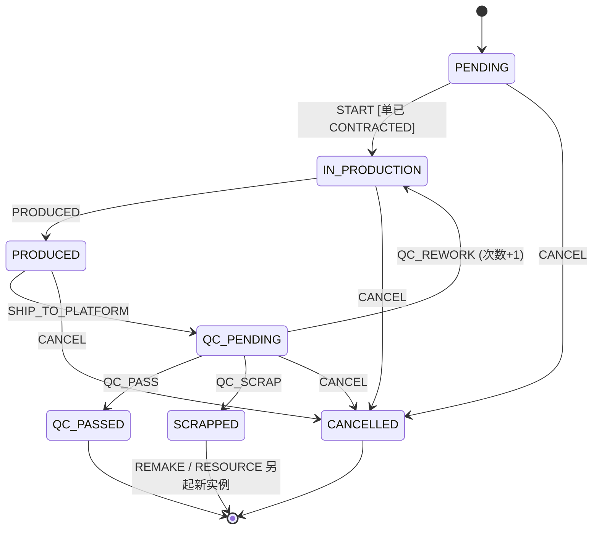

# 12 — 订单与零件状态机

> 编写日期：2026-09-08 ～ 09-09 ｜ 状态：**骨架已拍板，状态机本身大部分是【建议】，不能直接照着建**
>
> ## ★ 2026-09-09 修订：区分「需求方定的」和「助手提的」
>
> 本文档原先整篇标注为「已拍板」，实际上其中**状态名、事件名、守卫、触发者、
> 自动流转**大多是助手命名和裁定的，需求方没有逐个确认过。已按文档 10 / 11 的标注约定重标：
>
> | 标注 | 含义 |
> |---|---|
> | 【已拍板】 | 需求方明确说过的，**是决策** |
> | 【建议】 | 助手的判断，**不是决策**，可以被推翻 |
> | 【待确认】 | 没人定过，或与已定的东西冲突，**动手前必须问** |
>
> **已删除**（凭空造的政策，见 CLAUDE.md 强制约束「不许胡编乱造」）：
> - `SHIPPED --AUTO_COMPLETE [N 天]--> COMPLETED`：系统替客户认收货。谁定的 N、要不要自动，全没依据。
> - `CONTRACT_PENDING --TIMEOUT [N 天]--> CANCELLED`：不签超时自动废单。同上。
> - 原 §9「已定的默认假设（**未反对即按此建**）」整章：这是 C5 点名禁止的做法 —— 报备不是授权。
>
> **两处与已定内容正面冲突，见 §4 和 §3 的醒目标注，必须先解决再动手。**
>
> ---
>
> **本文档只定状态、事件、守卫、触发者和跨单传播规则，不定表字段细节、不定接口、不写代码。**
>
> 引擎思路（COLA 式表驱动）：`(当前状态, 事件, 守卫) → (目标状态, 动作)`，
> `next()` 是纯函数；状态存在订单/零件表里，状态机只是裁判。**这部分是工程决策，不是业务需求。**
>
> ⚠ **`status` / `fulfillment_status` / `superseded_by` / `rework_count` 这四个列
> 目前在任何迁移里都不存在**（`2026-09-08_05` 只建了归属、编号、溯源、时间、version）。
> 下文 §2–§7 读起来像它们已落库，实际没有。要建见 §11。

---

## 0. 五条总原则（违反任何一条 = 设计错误）

1. **状态只在自己的域内变。** 客户单、运营单、供应商单各管各的生命周期，只被自己域内的事件推动。**没有任何订单的状态是被另一张订单直接写的。**
2. **零件是履约的最小单元。** 真正被生产、发货、质检的是零件；物理进度只在叶子 `supplier_order_part` 上发生，它是全链**唯一跑真状态机的零件**。
3. **跨单靠"同事务事件 + 沿零件链向上聚合"，绝不级联写。** 下游转态后，在**同一个事务**里沿 `upstream_part_id` 向上重算上游零件汇总；汇总满足条件时触发上游订单**自己**状态机的守卫事件。每层只改自己、只看自己的零件。
4. **客户订单是必须交付的义务。返工、报废、供应商退单、运营单作废，全是供应链内部的事。** 它们只改变"货怎么做出来"，**永远不改变客户单的结果**。客户零件的终态只有 FULFILLED（合格到仓）或 CANCELLED（客户单自身取消）；供应侧的 SCRAPPED / CANCELLED **绝不**上传成客户零件的终态。
5. **转移表是数据，不是 if-else；流转用 CAS，不先查后改；状态机里不写业务。** `next()` 只判"能不能"，Action / 领域服务做"做什么"。CAS 条件里带租户归属。

---

## 1. 实体关系回顾（骨架表已建，迁移 `2026-09-08_05`）

```
customer_order ─1:N─ customer_order_part ──┐
ops_order      ─1:N─ ops_order_part  ─────┤  下游零件.upstream_part_id → 上游零件
supplier_order ─1:N─ supplier_order_part ─┘  + source_customer_order_id / source_customer_id 快照
                                            所有零件实例 → part_design（同一种零件，归某客户）
```

- 订单之间**不直连**；多对多 + 溯源全靠零件派生链。
- 一张运营单**整单**交给**一家**供应商（ops_order : supplier_order = 1 : 1）；一张运营单里的零件**可以来自多个客户单**。
- 派生只增不改：从不搬动零件实例；需要"换一条链"时新建实例并用 `superseded_by` 接上（见 §5）。

---

## 2. 客户订单 `customer_order` —— 一条主流程

**维度**：只做主流程一台机。生产/发货**进度**不是它的状态，是沿零件链聚合出来的（§7）。

### 状态
`DRAFT` → `SUBMITTED` → `QUOTED` → `CONFIRMED` → `READY` → `SHIPPED` → `COMPLETED`；终态 `COMPLETED` / `CANCELLED`。

### 转移表
```
DRAFT      --SUBMIT [≥1 零件]---------> SUBMITTED   (客户)
SUBMITTED  --WITHDRAW---------------> DRAFT       (客户，撤回改零件)
SUBMITTED  --QUOTE------------------> QUOTED      (运营)          ← 报价实体待定，暂裸转移
QUOTED     --REJECT-----------------> SUBMITTED   (客户，打回重报，可来回多次)
QUOTED     --CONFIRM----------------> CONFIRMED   (客户)          ← 报价有效期等守卫待报价域定后挂上
CONFIRMED  --ALL_PARTS_FULFILLED----> READY       (系统，聚合守卫：该单全部客户零件 = FULFILLED)
READY      --SHIP-------------------> SHIPPED     (运营，整单一次发给客户)
SHIPPED    --CONFIRM_RECEIPT--------> COMPLETED   (客户)
DRAFT | SUBMITTED | QUOTED --CANCEL--> CANCELLED  (客户自助)      ← 【待确认】能不能自助、限哪几个状态
CONFIRMED | READY --OPS_CANCEL------> CANCELLED   (运营)          ← 【待确认】见下方警告
```

> ⚠ **【待确认】运营能不能单方取消已确认的客户单。**
> §0 原则 4 引用的是需求方原话「**客户的订单必须完成**」，这里却给运营开了取消口子，
> 两者在同一份文档里打架。`OPS_CANCEL` 这条转移**没有出处**。
> 要么删掉，要么由需求方说明什么情况下运营可以毁约。

> **【建议】以下都是助手拟的，不是决策**：七个状态的名字；`WITHDRAW` 由客户触发；
> `REJECT` 可以来回多次；`CANCEL` 客户自助且只限 DRAFT / SUBMITTED / QUOTED。
> **动作归谁、能不能自助、能来回几次，都是需求的一部分**（CLAUDE.md §10 C5），需逐条确认。

- 【已删除】原本还有 `SHIPPED --AUTO_COMPLETE [N 天]--> COMPLETED`（系统定时替客户认收货）。
  N 是多少、要不要自动、超时后果，全无依据 —— 而客户会据此认为货已签收。
- `SHIPPED` 之后的取消/退换 = **售后**，不在本文档（待定）。
- `READY` 的守卫看的是客户零件的 **FULFILLED**（§7 映射后的值），不直接看叶子。



---

## 3. 运营订单 `ops_order` —— 一条主流程，两种派法

**结构决策**：整单交给一家。

> ⚠⚠ **【待确认】「发到市场供应商抢」这条线与已拍板的决策冲突，不能就这么建。**
>
> 文档 11 **D11【已拍板】**：「**定向派给能力匹配的几家，这几家之间先到先得**」，
> 并且在 §3.2 明确列出原型要改的地方：
> `supplier/HallPage` **从全市场大厅改为只显示派给我的**、
> `ops/DispatchPage` **「挂到订单市场」改为「选供应商派单」**。
>
> 本节的 `PUBLISHED`（已发市场待抢）/ `GRAB` / `UNPUBLISH`（运营撤回市场）
> **等于把 D11 否掉的全市场大厅模式又复活了**，而且是助手单方面加的，没有任何出处。
>
> 需求方要么确认 D11 改了，要么这三个状态/事件删掉，只留定向派单一条线
> （`ASSEMBLING → OFFERED → ASSIGNED`）。**在此之前不要建 `PUBLISHED` 这个状态。**

### 状态
`ASSEMBLING`（组装中）/ `PUBLISHED`（已发市场待抢）/ `OFFERED`（已直指待确认）/ `ASSIGNED`（已有供应商接下）/ `FULFILLED` / `CANCELLED`。

### 转移表
```
ASSEMBLING --PUBLISH [≥1 零件]-------> PUBLISHED   (运营)      ← 【待确认】与 D11 冲突，见上
ASSEMBLING --ASSIGN(某供应商)---------> OFFERED     (运营)      ← 【建议】方向与 D11 一致
PUBLISHED  --GRAB-------------------> ASSIGNED    (供应商)     ← 【待确认】与 D11 冲突，见上
PUBLISHED  --UNPUBLISH--------------> ASSEMBLING  (运营)       ← 【待确认】与 D11 冲突，见上
OFFERED    --ACCEPT-----------------> ASSIGNED    (供应商)
OFFERED    --DECLINE----------------> ASSEMBLING  (供应商拒接，回运营再定)
OFFERED    --REVOKE-----------------> ASSEMBLING  (运营收回指派)
ASSIGNED   --ALL_PARTS_FULFILLED----> FULFILLED   (系统，聚合守卫：未被替代的活跃零件全 QC_PASSED)
ASSIGNED   --SUPPLIER_DROPPED-------> ASSEMBLING  (系统：供应商退单 / 不签 / 待签超时 的事件，回来重派)
ASSEMBLING | PUBLISHED | OFFERED --CANCEL--> CANCELLED (运营)
ASSIGNED   --OPS_CANCEL-------------> CANCELLED   (运营；→ 事件 → 对应 supplier_order 走自己的取消；零件级联见 §6)
```

- **`GRAB` / `ACCEPT` 的动作**：同一事务内生成 `supplier_order`（ACCEPTED）+ 其 `supplier_order_part`（从本单 `ops_order_part` 派生）。
- 运营单不承载合同状态；合同阶段在供应商单上（§4）。



---

## 4. 供应商订单 `supplier_order` —— 粗主线

> ⚠⚠ **【待确认】下面这套「合同两步」和需求方的原话相反，不能就这么建。**
>
> **需求方原话**：「供应商接单还有一个创建合同的过程，**创建完合同就锁定了**。」
> 也就是说：**接单的动作里包含建合同，建完即锁**。
>
> **本节写成的**：运营建合同 → 供应商签字才锁定；`ACCEPTED` 和 `CONTRACT_PENDING` **都还能退**。
> 这把三件事都改了 —— 建合同的人从供应商变成运营、锁定点从建合同后移到签字后、
> 并且凭空开出一个「已接单但可以反悔」的窗口。全是助手改的，没有出处。
>
> 需求方确认之前，`CONTRACT_PENDING` 这个状态和 `CREATE_CONTRACT` / `SIGN` 两个事件都不要建。

**结构决策**：供应商发货**整单一次**（发给我们质检）—— 【待确认】，分批交付见 §10；
"我们 → 客户"的交付是客户单的事（§2）。

### 状态
`ACCEPTED` / `CONTRACT_PENDING` / `CONTRACTED` / `IN_PROGRESS` / `SHIPPED` / `FULFILLED` / `CANCELLED`。

### 转移表
```
ACCEPTED         --CREATE_CONTRACT-----> CONTRACT_PENDING (运营建合同，待签)     ← 合同实体待定，暂裸转移
CONTRACT_PENDING --SIGN----------------> CONTRACTED       (供应商签 = 锁定，不可退不可改)
CONTRACTED       --FIRST_PART_STARTED--> IN_PROGRESS      (系统，聚合：首个零件 START)
IN_PROGRESS      --SHIP----------------> SHIPPED          (供应商，整单发给我们；守卫：全部活跃零件 PRODUCED)
SHIPPED          --ALL_PARTS_QC_PASSED-> FULFILLED        (系统，聚合：未被替代的活跃零件全 QC_PASSED)
SHIPPED          --ANY_PART_REWORK-----> IN_PROGRESS      (系统，聚合：有零件被判返工 / 报废后重做)
ACCEPTED | CONTRACT_PENDING --WITHDRAW-> CANCELLED (供应商退单)  ← 【待确认】接单后到底能不能退
任一非终态        --OPS_CANCEL(事件)-----> CANCELLED (来自运营单的取消)
```

- 【已删除】原本还有 `CONTRACT_PENDING --TIMEOUT [N 天]--> CANCELLED`（不签超时自动废单）。
  N 是多少、超时后果、要不要自动，全无依据。
- 【待确认】锁定点在哪：本节写的是签字，需求方原话是建完合同即锁。见本节开头的警告。
- 返工件 / 重做件做好后**单件**再发给我们（"整单一次发"只管首次交付）。



---

## 5. 叶子零件 `supplier_order_part` —— 唯一的真物理机（含质检、返工、报废）

**质检**：供应商做好 → 整单发给**我们** → **我们按零件质检** → 合格 / 返工 / 报废。质检是零件维度，决定权在运营。

### 状态
`PENDING` / `IN_PRODUCTION` / `PRODUCED` / `QC_PENDING` / `QC_PASSED` / `SCRAPPED` / `CANCELLED`。

### 转移表
```
PENDING       --START---------------> IN_PRODUCTION  (供应商；守卫：所属供应商单已 CONTRACTED)
IN_PRODUCTION --PRODUCED------------> PRODUCED       (供应商，做好等发)
PRODUCED      --SHIP_TO_PLATFORM----> QC_PENDING     (首次由整单 SHIP 批量触发；返工/重做件单件触发)
QC_PENDING    --QC_PASS-------------> QC_PASSED      (运营；终态 = 该件履约完成)
QC_PENDING    --QC_REWORK-----------> IN_PRODUCTION  (运营)  ← 【待确认】同实例回炉、part_no 不变、计次数，是助手定的实现语义，且动了需求方定过的 part_no 规则
QC_PENDING    --QC_SCRAP------------> SCRAPPED       (运营；终态，只标记，不自动生成任何东西)
任一非终态     --CANCEL(级联事件)------> CANCELLED      (见 §6)
```

### 报废之后（补料）—— 两条命令，都是"生成新实例"，不是报废件的转移
- `SCRAPPED` 且 `superseded_by` 为空 = 运营的**待处理报废**清单。运营二选一：
  - **REMAKE（原厂重做）**【待确认】原本标的是「默认路径」——「报废后默认让出问题的那家重做」是业务政策，没有出处，已去掉「默认」二字：在**同一张** `supplier_order` 里建新 `supplier_order_part`（新 part_no，PENDING），上游仍是同一 `ops_order_part`；旧件 `superseded_by = 新件`；供应商单回 `IN_PROGRESS`。
  - **RESOURCE（换家）**【待确认】触发条件、是否需要客户/供应商知情、原供应商责任边界均未定：从同一 `customer_order_part` 重新派生一条新链进**另一张**运营单（新 `ops_order_part` → 之后新 `supplier_order_part`），旧链 `superseded_by` 接上。
- **各单 FULFILLED 的守卫 = 所有"未被替代"的活跃零件全 QC_PASSED。** 由此：原厂重做时新件仍在原单 → 原单等新件合格才完成；换家时需求已离开原单 → 原单可正常完成，原厂只对剩下的零件负责。
- 溯源两头都在：新件查得到"替代了哪个报废件"，报废件查得到"被谁替代"。



---

## 6. 取消：按零件走，不按整单

**问题**：一张运营单里混着多个客户的零件。客户 A 取消不能把 B 的零件也取消掉。

**规则**
- `ops_order_part` / `supplier_order_part` 各加 `CANCELLED`（客户零件的取消只来自客户单自身，见原则 4）。
- **客户单 OPS_CANCEL**（CONFIRMED / READY）→ 只取消**它派生出去的**零件（沿链向下 CANCELLED）；下游运营单 / 供应商单若还有其他客户的活跃零件则**继续**；
  【待确认】「活跃零件归零就**自动**取消下游单」这条阈值规则没有出处 —— 自动取消一张供应商单是有后果的动作。
- **运营单 OPS_CANCEL** → 其全部零件 CANCELLED，对应供应商单走自己的取消；里面的**客户零件需求并没消失** → 回"待重派"。
  【待确认】谁负责重派、是否自动、客户是否知情，均未定。
- **供应商退单 / 不签 / 超时** → 供应商单 CANCELLED，其零件 CANCELLED，运营单 `SUPPLIER_DROPPED` 回 ASSEMBLING 重派（运营单和它的零件不取消，只是回到待派）。
- **方向不对称**：向下的取消（客户 → 运营 → 供应商）会级联；向上（供应侧出事）**永远不取消客户单**，只是让客户零件回到待重派。

---

## 7. 客户视角的零件状态：映射，不是镜像

| 表 | `fulfillment_status` 取值 | 含义 |
|---|---|---|
| `supplier_order_part`（叶子） | §5 全部 7 个状态 | 真状态机 |
| `ops_order_part` | 与叶子同值（含 SCRAPPED / CANCELLED） | 运营看供应细节；由事件回写 |
| `customer_order_part` | **`PENDING` / `IN_PROGRESS` / `FULFILLED` / `CANCELLED`** | 客户只看"到没到" |

**叶子 → 客户零件的映射**
```
无活跃下游链（未派 / 被取消 / 报废待重派）  → PENDING      (需求开着，等运营派)
IN_PRODUCTION | PRODUCED | QC_PENDING     → IN_PROGRESS
返工回炉 / 报废后 REMAKE 或 RESOURCE 的新链  → 【待确认】IN_PROGRESS 还是 PENDING
QC_PASSED                                → FULFILLED    (终态)
客户单自身 CANCEL / OPS_CANCEL             → CANCELLED    (唯一能给客户零件终态的取消)
```
- 客户零件的 `READY` 守卫看 `FULFILLED`。
- 客户零件**永远不显示** SCRAPPED、供应侧 CANCELLED、REWORK —— 那些折成 IN_PROGRESS / PENDING。
  这一条有出处：需求方原话「客户的订单必须完成，返工报废是针对供应商的」。

> ⚠ **【待确认】上表那一行的「或」必须定死一个。** 客户看到「在做」还是「待安排」，
> 是他会据此判断自己的件到哪了的事实。规范里留一个二选一，等于把这个判断丢给了实现者。

> **【待确认】客户零件状态是派生量这件事本身。** 需求方只说过三张单各有自己的零件行，
> 没说客户零件的状态是从叶子回写出来的。这是助手的设计（§0 原则 2），不是需求。

---

## 8. 事件与事务

- **向上传播同事务同步**：叶子 CAS + 上游回写 + 上游聚合转态在同一个 `@Transactional` 里（全在一个库），要么全成要么全回滚。**不会出现"叶子合格了、客户单没更新"。**
- **outbox / 本地消息表只给对外消息**（邮件 / 企微 / 通知），不在事务里直接 send。
- **CAS**：`update … set status = 目标, version = version + 1 where id = ? and status = 当前 [and 归属 org = ?]`，`affectedRows == 0` 即被抢先，抛非法流转。业务动作放 CAS 成功之后。
- **并发聚合**：两个零件同时合格、同时触发"全部合格了吗"，只有第一个 CAS 成功把订单推到 FULFILLED，第二个自然失败并忽略。聚合判断在 CAS 条件内重读。
- **接单唯一性**：`→ ASSIGNED` 的 CAS 天然保证只有一家接到，不需要分布式锁。
  （原文写的是 `PUBLISHED → ASSIGNED` 的抢单，那条线本身待确认，见 §3。
  定向派单下同样需要这个 CAS —— D11 是「派给几家，先到先得」。）

---

## 9. 【待确认】原「已定的默认假设（未反对即按此建）」

> **这一章原本叫「已定的默认假设（未反对即按此建）」。**
> 「未反对即生效」是给凭空造的东西加一个免责声明，正是 CLAUDE.md §10 C5
> 点名禁止的做法：**报备不是授权**。三条全部降级为待确认。

1. **【建议】报价 / 合同待定 → `QUOTE`、`CONFIRM`、`CREATE_CONTRACT`、`SIGN` 先做裸转移。**
   这条方向是对的（那两块确实由需求方明确延后了），可以保留为工程做法。
2. **【待确认】两条守卫**：零件 `START` 要求所属供应商单已 `CONTRACTED`；
   供应商单 `SHIP` 要求全部活跃零件 `PRODUCED`。两条都是助手拟的，
   而且第一条依附于 §4 那个未经确认的合同模型。
3. **【待确认】谁能触发**。「端级 + 租户归属」是安全底线（CLAUDE.md §3），这部分是对的；
   但**具体哪个事件归哪一端**（客户能不能自助取消、运营能不能取消已确认单、
   供应商能不能退单）逐条都没定，见 §2 §3 §4 的标注。

   ⚠ 另有一个**实现层面的缺口**：CAS 条件要带租户 org id，但
   `ops_order` 和**四张零件表目前都没有 org 列**（见 `2026-09-08_05`）。
   要么先查父单校验归属、CAS 只带 status，要么给零件表加冗余 org 列 —— 这是建模决策，需先定。

---

## 10. 待定项（不阻塞状态机落地）

| 项 | 归属 | 说明 |
|---|---|---|
| 报价实体、有效期、审批（D14 最简版）、汇率快照 | 报价域 | 挂到 `QUOTE` / `CONFIRM` 的守卫上 |
| 合同实体、对供价、交期、签署信息、文件 | 合同域 | 挂到 `CREATE_CONTRACT` / `SIGN` 上 |
| 取消赔付、返工/报废扣款 | 价格域 | 不改状态机 |
| 售后（SHIPPED 后取消 / 退换 / 索赔） | 待定 | 可能是客户单的一个正交维度 |
| 分批交付客户 | 待定 | 【待确认】「现为整单一次发」并没有人定过，但它已经被写进 §2 和 §4 的守卫里 |
| 审批人 / QC / 取消的细粒度角色 | 角色 | 角色表种值后收紧 |
| 发票 / 回款状态（D15） | 结算域 | 单独一块 |

---

## 11. 落地清单

> ⚠ **这份清单现在不能直接照着做。** §3（市场抢单 vs D11）、§4（合同锁定点）
> 两处与已定内容冲突，§2 §5 §6 §7 §9 里还有若干【待确认】。
> 先把那些定下来，转移表才有确定的内容可落。下面是**定完之后**的步骤。

1. **迁移**：`customer_order` / `ops_order` / `supplier_order` 加 `status`（text + CHECK）；三张零件表加 `fulfillment_status`；`ops_order_part` / `supplier_order_part` 加 `superseded_by`（uuid，可空）；`supplier_order_part` 加 `rework_count`（int，默认 0）；相应索引。
2. **引擎**（`platform/statemachine`，业务无关）：`Transition(from, event) → to` 表 + 守卫接口 + 纯函数 `next()` + CAS `apply()`（带租户条件、抛非法流转）+ 同事务领域事件。
3. **四张转移表**（`domain/order`）作为数据；守卫与动作在领域服务。
4. **向上聚合回写**：事件处理器沿 `upstream_part_id` 回写 `fulfillment_status`（运营层同值、客户层按 §7 映射），并触发上游订单的聚合事件。
5. **测试**：每台机全路径遍历（从转移表自动枚举）、非法流转告警、CAS 并发（两零件同时合格 / 两家同时抢单）、级联取消、报废重做与换家的守卫。
6. **出图**：从转移表自动生成 Mermaid。
   【待确认】本文档 §2–§5 的 mermaid 是手写散文体（一条边上写两个事件、
   `SCRAPPED --> [*]: REMAKE / RESOURCE 另起新实例` 根本不是一条转移、边标签带中文守卫），
   按「漂移即测试红」逐字比对会第一天就红。要么改文档的图，
   要么把对照降级成 `(from, event, to)` 三元组集合比对。
